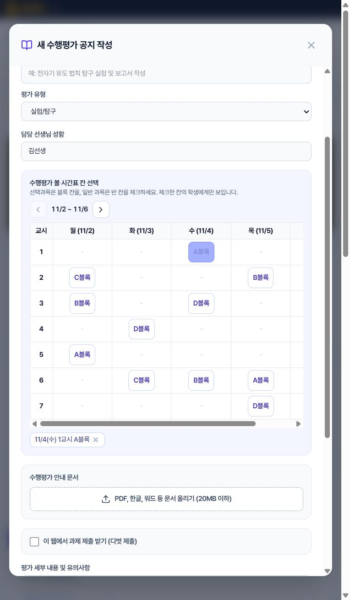
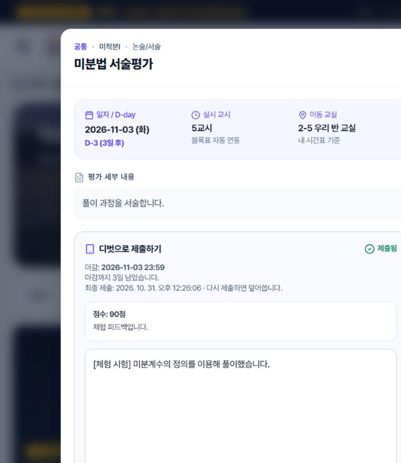
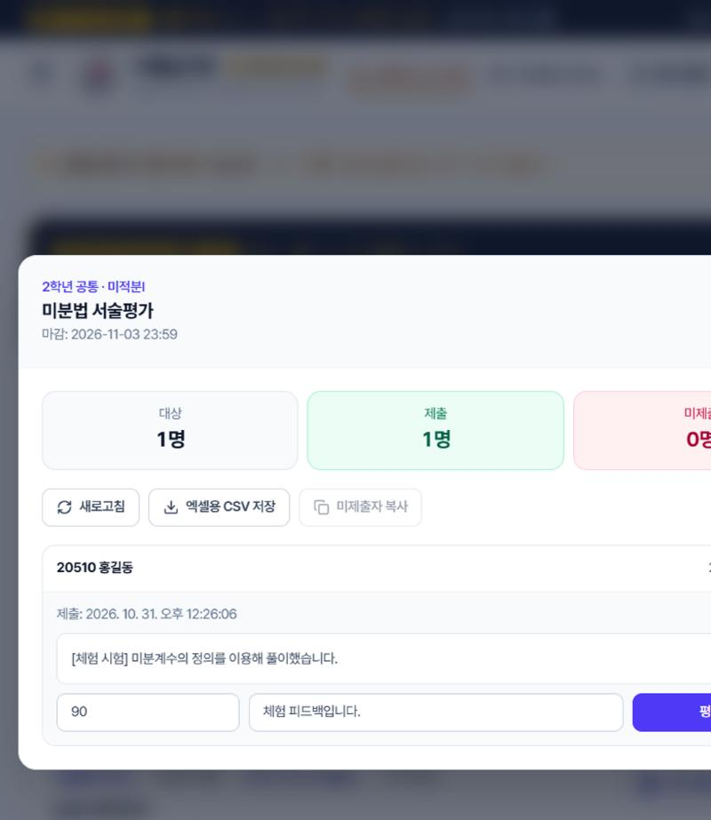

# [PAD] 수행알리미 (Performance Assessment Notification)

> 한 줄 소개: 선택과목이 달라 내 수행평가를 놓치기 쉬운 중산고 학생에게, 내 날짜·교시·교실·준비물만 골라 보여 주는 웹 서비스 (개인 참가)

**코드 출처 안내:** `classfit` 폴더의 앱은 대회 시작 전에 작성한 코드에서 출발했으며, ICT기획부의 허락을 받아 사용했습니다. 09:20 이후의 변경 내역은 커밋 기록에서 확인할 수 있습니다.

## 1. 문제

**문제 한 문장:** 중산고 2·3학년 학생들은 수행평가 공지가 올라올 때마다, 선택과목이 학생마다 달라서 내 평가의 날짜·교시·준비물을 시간표와 직접 맞춰 봐야 하고 그 과정에서 놓치기 쉽다.

**상황:** 2학년은 A-D, 3학년은 E-H 블록마다 듣는 과목과 교실이 다르다. 같은 반이어도 수업이 달라서 반 공지로는 내 평가인지 바로 알 수 없다. 같은 과목도 반이나 블록마다 평가일이 달라 학생이 직접 시간표와 대조해야 한다.

**근거:**
- 개발자 본인이 학생으로서 공지와 시간표를 직접 대조해야 하는 불편을 겪었다.
- 컴시간 시간표에서 같은 학년도 반마다 블록 위치의 과목이 다른 것을 직접 확인했다.
- 설문은 진행하지 못해 다른 학생 응답 수는 적지 않는다.
- NEIS 시간표를 확인하니 3학년은 같은 교시에도 반마다 과목이 다르고, 교시당 최대 11개 과목이 동시에 열린다.

## 2. 해결

**핵심 시나리오:** 선생님이 내 과목을 고른다 → 시간표에서 평가를 볼 블록 칸이나 반 칸을 체크해 등록한다 → 해당 학생에게만 D-Day·교시·교실·준비물이 보인다 → 학생이 디벗으로 제출한다 → 선생님이 제출 현황에서 채점하고 피드백을 보낸다

| 구분 | 기능 |
| --- | --- |
| 필수 (15:30까지 반드시) | 학생별 선택과목 고르기, 시간표 칸 기준 평가 등록, 해당 학생에게만 표시, D-Day·교시·교실·준비물 체크 |
| 선택 (시간이 남으면) | 평가 문서 업로드, 디벗 온라인 제출, 제출 현황과 채점, NEIS 실제 시간표, 공휴일 표시, 시간표 관리, 푸시 알림, AI 비서 |
| 제외 (오늘 하지 않음) | 컴시간·리로스쿨 실제 연동, 비밀번호 찾기, 학부모 화면 |

**완성 여부 (15:30 기준)**
- [x] 학생별 선택과목 고르기
- [x] 시간표 칸 기준 평가 등록 (블록·반)
- [x] 해당 학생에게만 평가 표시
- [x] D-Day, 교시, 교실, 준비물 체크
- [x] (선택) 평가 문서 업로드, 온라인 제출, 채점과 피드백
- [x] (선택) NEIS 실제 시간표, 공휴일·방학 표시
- [x] (선택) AI 비서 (체험 사이트는 규칙 기반)
- [x] (선택) 매일 아침 D-Day 푸시 (서버 연결 완료, 예약 발송은 다음 날 확인 필요)

**문제에서 기능까지 연결**

| 문제 | 기능 | 확인 방법 |
| --- | --- | --- |
| 내 평가인지 시간표와 직접 대조해야 한다 | 블록과 과목이 맞는 학생에게만 표시 | 자동 테스트, 학생 계정 비교 시험 |
| 같은 과목도 반·블록마다 평가일이 다르다 | 시간표 칸 단위로 평가 등록 | 김체험(F블록)은 월 4교시로 표시 |
| 이동 교실과 교시를 찾기 어렵다 | 블록 위치로 교시 계산, 학생별 교실 표시 | 컴시간·NEIS 교차 검증 |
| 준비물을 잊는다 | 평가 준비물과 내 시간표 교과서 체크 | 자동 테스트 |
| 교사가 제출과 미제출을 따로 확인해야 한다 | 온라인 제출, 제출 현황, 채점 | 제출 → 채점 → 학생 피드백 시험 |

## 3. 설계

**화면 흐름:**
- 학생: 체험 선택 → 홈(가까운 평가) → 평가 상세(준비물·제출) → 주간 시간표
- 선생님: 체험 선택 → 평가 목록 → 평가 등록(시간표 칸 체크) → 제출 현황 → 시간표 관리

**데이터 구조:**

```
student:    id, name, grade, classNum, studentNum,
            courses[{ block, subject, room }],
            checkedSupplies, completedAssessments
assessment: id, subject, targetGrade, title, type, supplies, description,
            documents[], submission{ mode, deadline },
            slots[{ date, period, block | classNum }]
submission: id, assessmentId, studentId, content, files[],
            submittedAt, isLate, score, feedback
settings:   layouts(학년별 블록 위치), overrides(반별 시간표 수정)
```

**설계 결정 기록:**

| 결정 | 이유 | 버린 안 |
| --- | --- | --- |
| 평가 날짜 대신 시간표 칸을 체크 | 같은 평가도 반·블록마다 날짜가 다르다 | 날짜 하나만 입력 |
| 블록 위치를 학년별로 저장 | NEIS는 블록 표시가 없고, 같은 학년은 모든 반이 같다 | 반별로 저장 |
| 키는 서버 함수에서만 사용 | 공개 저장소와 브라우저에 키가 노출되면 안 된다 | 브라우저에서 직접 호출 |
| 미래 주는 현재 시간표 반복, 학사일정으로 쉬는 날 표시 | NEIS에 없는 주에도 평가를 등록해야 한다 | 미래 주 등록 불가 |
| 체험 사이트를 따로 운영 | 로그인 없는 공개 사이트에서 Gemini를 쓰면 크레딧이 나간다 | 실제 서비스를 그대로 공개 |

**기술 선택:**
- 선택: React, TypeScript, Tailwind CSS, Vercel Functions, Supabase, NEIS 공공 API, Gemini API, Web Push
- 이유: 교사와 학생이 다른 기기에서 같은 평가를 봐야 하므로 서버 저장이 필요하다. NEIS 키와 서버 키는 브라우저에 노출하지 않도록 서버 함수에서만 쓴다.
- 고르지 않은 안: GitHub Pages와 localStorage만 쓰는 방식 — 기기 간 공유와 키 보호가 불가능하다.
- 고르지 않은 안: 체험 사이트의 Gemini 연결 — 로그인 없이 누구나 쓰면 호출마다 크레딧이 나간다.
- 막히면: NEIS를 못 받아도 앱은 열리고 안내를 보여 준다. Supabase가 끊기면 평가는 브라우저 저장으로 동작한다.

## 4. 실행 링크·실행 방법

- 체험 링크: https://previewclassfit.vercel.app/ (로그인 없이 학생과 선생님을 모두 체험, 코드는 https://github.com/beakjunseok/preview_classfit)
- 실제 서비스: https://classfit-nine.vercel.app/ (학번·이름·비밀번호 로그인, Gemini 연결)
- 시연용 사용자: 김선생, 홍길동(2-5), 김체험(3-1), 이체험(3-2), 박체험(1-1) — 모두 가짜 데이터
- 체험 데이터는 다른 체험자와 공유되므로 개인정보를 넣지 마세요.
- 자동 테스트: `classfit` 폴더에서 `npm test`, 푸시할 때마다 GitHub Actions가 실행합니다.
- 직접 실행: `classfit` 폴더에서 `npm install` 후 `npm run dev`. 값은 `classfit/.env.example`을 참고하고, 서버 준비는 `classfit/supabase/schema.sql`을 실행합니다.

## 5. 실행 화면

시연용 가짜 데이터로 2절 시나리오 순서대로 캡처했습니다.

| 시간표 칸으로 평가 등록 | 학생 맞춤 평가와 제출 | 제출 현황과 채점 |
| --- | --- | --- |
|  |  |  |

**시험 결과**

| 시험 | 방법 | 결과 |
| --- | --- | --- |
| 핵심 로직 15개 | GitHub Actions 자동 테스트 (`classfit/src/utils/core.test.ts`) | 통과 |
| 블록 위치 | 컴시간 캡처를 NEIS 학년 전체 시간표와 비교 | 2학년 11개 반, 3학년 12개 반 모두 일치 |
| 평가 공개 범위 | 5반 칸으로 등록 후 2-5, 3-1 학생 화면 비교 | 해당 학생에게만 표시 |
| 제출과 채점 | 학생 제출 → 교사 채점 → 학생 피드백 확인 | 통과 |
| PDF 분석 | 교사 화면에 스캔형 PDF 입력 | 5.8초에 양식 입력. 처음에는 90초 이상 걸려 빠른 모델로 교체 |
| 입력 차단 | 빈 제출, `.exe` 파일, 21MB 파일 | 모두 거부 |
| 인증 | 틀린 등록 코드, 위조 토큰 | 모두 거부 |
| AI 비서 범위 | 관련 없는 질문, 욕설 | 거절 안내 |
| 버그 수정 사례 | 고정돼 있던 D-Day 기준일, 새 학생 세션 이름, 과목 목록 지연 시 학년 | 시험 중 발견해 수정 |

## 6. AI 활용

| 단계 | 도구 | 어떻게 썼나 |
| --- | --- | --- |
| 기획 | Claude Code | 대회 평가 기준을 대조해 부족한 기능과 가짜 기능을 찾음 |
| 코드 작성 | Google AI Studio, Claude Code | 대회 전 초기 코드는 AI Studio, 당일 기능 구현은 Claude Code로 작성 |
| 오류 해결 | Claude Code | 빌드·배포·서버 오류 메시지를 주고 원인을 찾아 수정 |
| 서비스 기능 | Gemini API | 실제 서비스의 AI 비서와 PDF 분석. 체험 사이트는 크레딧 때문에 제외 |

**효과적이었던 요청:**

```
선택과목 선생님들은 A,B,C,D,E,F,G,H으로 되어있는 시간표에서
수행 보는 맞는 날짜 요일 교시인 시간표 칸을 체크하는 방식으로 하고
만약 선택과목 선생님이 아닐 경우 자신의 과목의 시간표가 보이도록
```

**AI 결과에서 직접 고친 부분:**
- 날짜 입력을 시간표 칸 체크 방식으로 바꾸고, 반마다 평가일이 다르게 수정 지시함
- 컴시간 화면을 직접 캡처해 학년별 블록 위치를 제공했고, 1학년은 선택과목이 없다고 수정 지시함
- 날짜 입력 방식을 시간표 칸 체크 방식으로, 과목 입력을 드롭다운으로, 이동 교실을 층-반 형식으로 바꾸도록 지시함

## 7. 역할

| GitHub 아이디 | 맡은 일 | 주요 파일 |
| --- | --- | --- |
| beakjunseok | 개인 참가. 기획, 요구사항 결정, AI로 구현, 실제 기기 시험, 배포, 발표를 혼자 맡음 | README.md, classfit/src/, classfit/api/ |

## 8. 한계와 다음 계획

**한계:**
- 평가와 제출물 데이터는 공개 키로 접근할 수 있어 로그인이 지켜 주지 못한다. 시연용 가짜 데이터만 넣어야 한다.
- 체험 사이트는 로그인이 없어 누구나 평가와 제출물을 보고 고칠 수 있다.
- 체험 사이트의 AI 비서는 정해진 키워드에만 답하고, PDF 요약은 꺼져 있다.
- NEIS는 교사별 분반 정보를 주지 않아, 한 블록에 같은 과목이 두 반 열려도 구분하지 못한다.
- 학생의 과목 선택과 체크 상태는 체험 브라우저에만 저장된다.
- 웹 알림은 밀어서 지울 수 있고 갱신은 하루 한 번이다. 아이폰은 홈 화면에 추가해야 받을 수 있고 실기기로 시험하지 못했다.
- 비밀번호 찾기가 없다.
- AI 문서 분석은 PDF, PNG, JPG, TXT 3MB까지만 지원하고 결과는 교사가 확인해야 한다.

**다음 계획:**
1. 평가와 제출물 접근을 로그인 기준으로 제한하기
2. 교사별 분반을 등록해 같은 과목의 반을 구분하기
3. 학생 과목을 학교 수강 신청 자료와 연결하기
